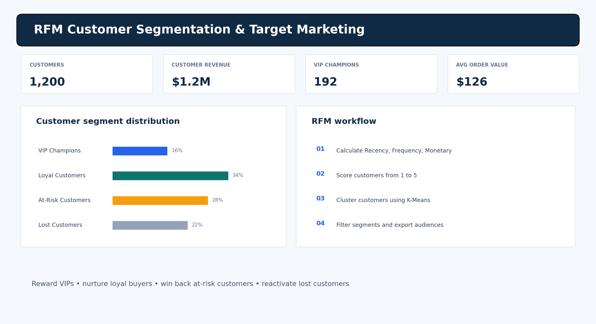

# RFM Customer Segmentation & Target Marketing

Portfolio project using **Python, SQL, K-Means, Streamlit, Pandas, NumPy and Plotly** to turn transaction history into customer segments and exportable campaign audiences.



## Business problem
One-size-fits-all marketing wastes budget. RFM analysis identifies high-value, loyal, at-risk and inactive customers for tailored campaigns.

## Features
- Calculate Recency, Frequency and Monetary values per customer.
- Score RFM metrics from 1–5 using quintile ranks.
- K-Means clustering on standardized log-transformed RFM features.
- Interactive segment distribution and revenue charts.
- Filter customer records and export segment email lists as CSV.
- Upload your own transactions CSV.
- PostgreSQL examples in `sql/rfm_analysis.sql`.

## Segment descriptions
- **VIP Champions:** recent, frequent, high-value customers.
- **Loyal Customers:** repeat buyers with strong engagement.
- **At-Risk Customers:** customers whose last purchase is becoming less recent.
- **Lost Customers:** customers with low engagement and long inactivity.
- Additional cluster labels appear when selecting more than four clusters.

Cluster names are assigned by relative average RFM quality; tune business thresholds for your buying cycle.

## RFM definitions
| Metric | Meaning | Better |
|---|---|---|
| Recency | Days since latest purchase | Lower |
| Frequency | Distinct orders | Higher |
| Monetary | Total customer spend | Higher |

## Project structure
```text
rfm-customer-segmentation/
├── app.py
├── requirements.txt
├── README.md
├── .gitignore
├── data/transactions.csv
├── sql/rfm_analysis.sql
└── docs/dashboard-preview.png
```

## Run on Windows PowerShell
```powershell
python -m pip install -r requirements.txt
python -m streamlit run app.py
```
Open `http://localhost:8501`.

## Input CSV
Required columns: `customer_id`, `email`, `order_id`, `order_date`, `amount`. Optional: `customer_name`. The included data is synthetic and uses fictional email addresses.

## Data and privacy notes
Deduplicate orders; decide how to treat refunds, cancellations, tax and shipping; use a stable customer ID; and comply with consent, privacy and unsubscribe rules before using exported audiences. K-Means is sensitive to scaling, outliers and cluster count. Review profiles before activating campaigns.

## Suggested GitHub repository
**Name:** `RFM-Customer-Segmentation`

**Description:** Customer analytics project using RFM scoring, K-Means clustering, SQL and an interactive Streamlit dashboard for targeted marketing.

**Topics:** `customer-segmentation` `rfm-analysis` `kmeans-clustering` `customer-analytics` `sql` `python` `streamlit` `marketing-analytics`

## Resume description
Built an RFM customer analytics workflow using Python and SQL, applied K-Means clustering to identify customer groups, and developed an interactive Streamlit dashboard with segment filters and CSV audience exports.
